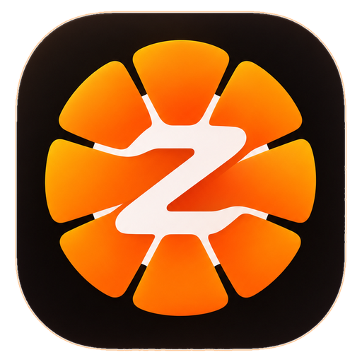
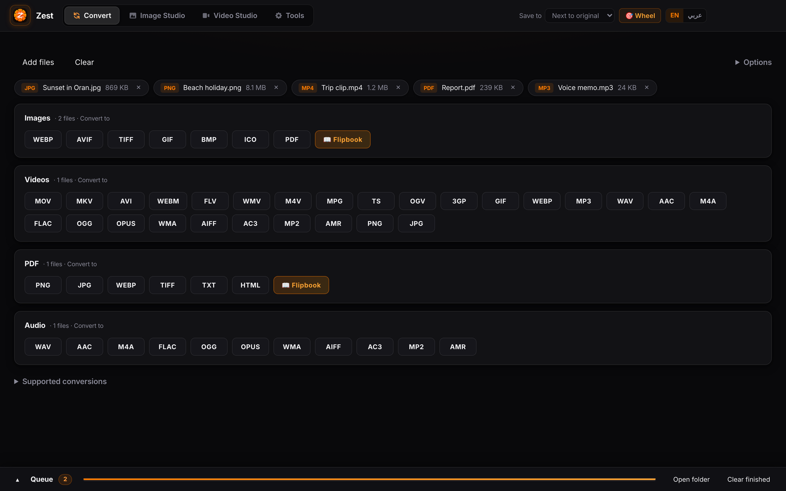
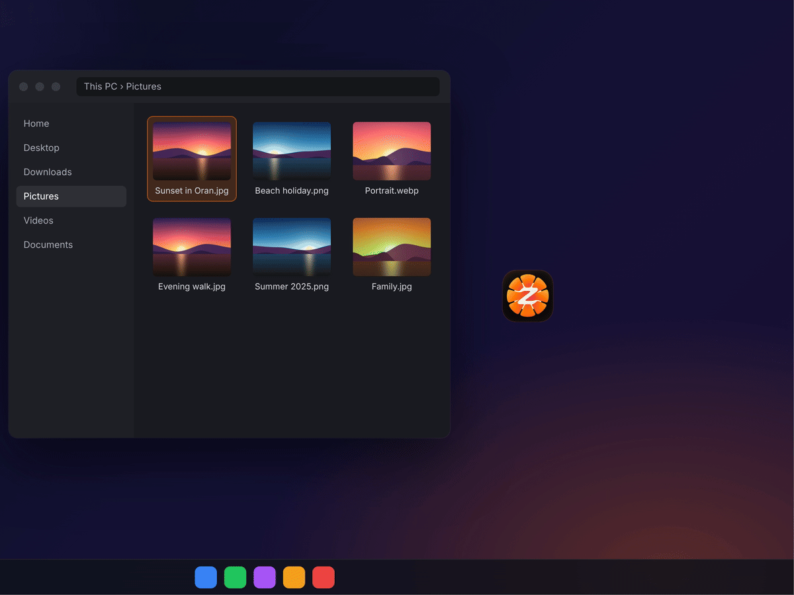
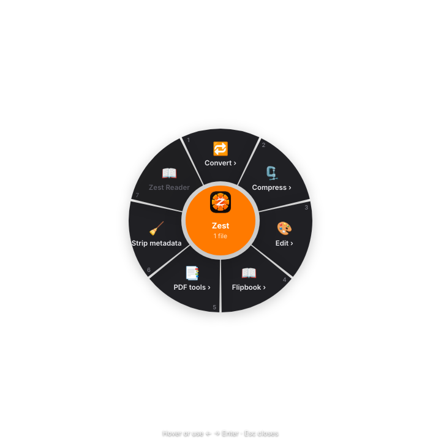
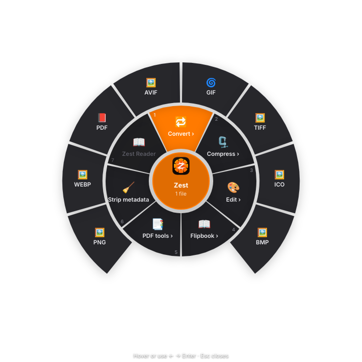
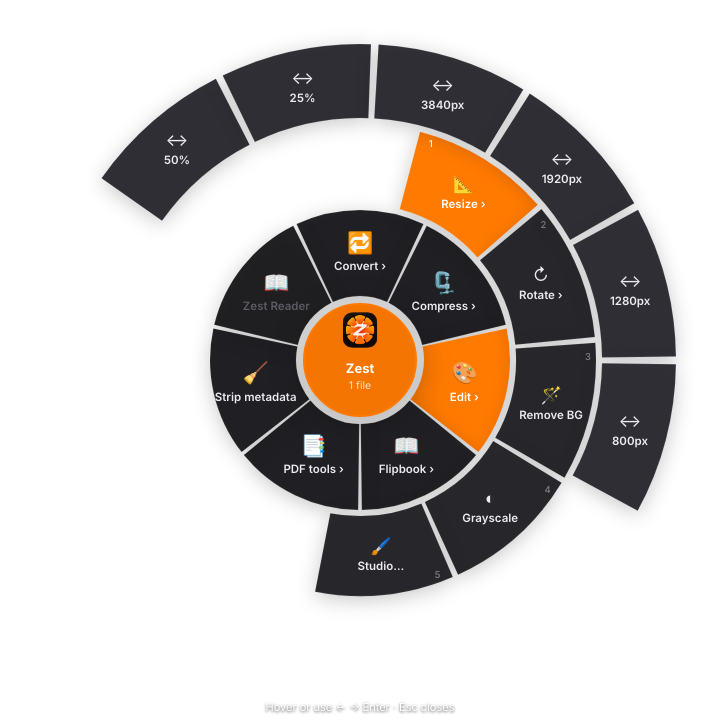
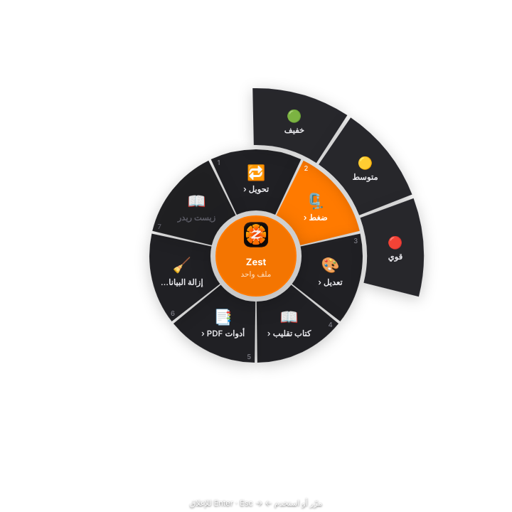

<div align="center">



# Zest

**Convert, compress and edit files on Windows without uploading anything.**
A floating bubble and a right-click radial wheel, 100 % offline.

[**Download**](https://github.com/MohamedBen21/Zest/releases/latest) · [Features](#features) · [Build from source](#build-from-source) · [Known gaps](#known-gaps)



</div>

> Drop an image, video, audio file, PDF, e-book or document onto the bubble. A pie menu opens at the bubble, you pick a format, and the converted file appears next to the original. No account, no cloud, no network. The app blocks every network request, so your files never leave the PC.

<!-- Add docs/demo.gif here: bubble → drop file → wheel → converted file (10-15 s) -->


## Why Zest
- **Private by design.** FFmpeg, libvips (sharp), MuPDF and pdf-lib are bundled and run locally. Every network request from the app is blocked.
- **Fast to reach.** A small floating bubble, a tray icon and two global hotkeys put conversion one drag away.
- **One tool for many jobs.** 875 input → output conversions, two editing studios and 31 batch tools.
- **Free and open source.** English and Arabic (RTL) interface, dark theme.

## Features

### The bubble
A small square icon that floats above the Desktop and File Explorer. It stays out of your way in other apps.
- Drag files onto it to open the wheel next to it. The bubble rides to the wheel's centre and returns to where you left it.
- Pick a size (**S / M / L**) from the hover buttons. Zest remembers your choice.
- The **–** button sends it away. Bring it back from the tray icon, the tray menu or **Ctrl+Alt+B** (appears at your cursor).
- It refuses to sit on top of desktop icons: it shakes and glides back to where it was.
- It runs without the main window and can start with Windows.

### The wheel
Right-click a supported file, a multi-selection or a folder in File Explorer and choose **Zest**, or press **Ctrl+Alt+M** with files selected.

| Categories | Convert → formats | Nested (Edit → Resize) | Arabic |
|---|---|---|---|
|  |  |  |  |

- The inner ring shows only what fits your files: Convert, Compress, Edit, Flipbook, PDF tools, Audio/Video tools, Strip metadata and Open in Zest Reader.
- The wheel always opens fully on screen. Hover or click to expand rings; use ← → Enter Backspace Esc or the keys 1–9.
- A small toast shows progress with **Show in folder** and **Open**. Existing files are never overwritten (`name (1).ext`).
- Subtle, optional **sound effects** (popups, slice changes, drop, success). Turn them off in the **Wheel** panel.

### The main window
Opens maximized. Drag in many files or whole folders and pick a target format.
- **Batch queue** with per-job progress, cancel and retry, and two parallel jobs by default.
- **Image Studio:** resize (pixels or percent), crop, rotate, flip, colour adjustments, DPI, quality, target size in KB, metadata stripping and plain-background removal.
- **Video Studio:** trim timeline, crop, resolutions up to 4K, FPS, CRF, bitrate or target size in MB (2-pass), speed, mute, loudness normalization, GIF/WebP and audio output.
- **Make flipbook:** PDFs, images, documents and e-books become a self-contained offline HTML flipbook.
- **Tools tab:** 31 batch tools such as merge, split, compress, rotate and protect PDFs, extract audio, video to GIF and strip metadata.
- **Edit PDF:** opens a PDF in [Zest Reader](https://github.com/MohamedBen21/zest-reader) 1.1.0 or later.

## Supported conversions
875 unique input → output pairs.

| Kind | Inputs | Outputs |
|---|---|---|
| Images | png, jpg, jpeg, jfif, webp, avif, tif, tiff, gif, bmp, heic, heif, svg, ico, tga, jp2, ppm, pgm, pcx | jpg, webp, avif, tiff, gif, bmp, ico, pdf, png, mp4, webm, flipbook |
| Video | mp4, mov, mkv, avi, webm, flv, wmv, m4v, mpg, mpeg, 3gp, ts, mts, m2ts, ogv, vob, f4v, asf | many video formats, gif, webp, audio formats, image frames |
| Audio | mp3, wav, aac, m4a, flac, ogg, oga, opus, wma, aiff, aif, amr, ac3, mka, caf, m4b, wv, mp2, au | wav, aac, m4a, flac, ogg, opus, wma, aiff, ac3, mp2, amr, mp3 |
| PDF | pdf | png, jpg, webp, tiff, txt, html, flipbook |
| E-books / XPS | epub, xps, oxps, cbz, fb2, mobi | pdf, png, jpg, txt, flipbook |
| Documents | md, markdown, html, htm, txt, docx | html, pdf, txt, docx, md, flipbook |
| Data | csv, tsv, json | json, tsv, html, csv |

## Install (Windows 10/11, x64)
1. Download from [**Releases**](https://github.com/MohamedBen21/Zest/releases/latest):
   - `Zest-Setup-<version>-x64.exe`: installer. Adds the right-click entry, Start-menu shortcuts and the bubble shortcut.
   - `Zest-Portable-<version>-x64.exe`: no install, runs from anywhere (no right-click entry).
   - `Zest-<version>-win-x64.zip`: unpacked app.
2. **SmartScreen warning.** Zest is not code-signed yet, so Windows may show *"Windows protected your PC"*. Click **More info → Run anyway**. You can inspect and build the source yourself below.
3. On Windows 11 the right-click entry is under **Show more options** (or Shift+F10). A top-level entry would need a signed MSIX package.
4. Optional check: `Zest.exe --self-test` runs a quick built-in converter test.

Command line: `Zest.exe --radial <files…>`, `--bubble`, `--background`, `--open-in-reader <file>`.
Logs: `%APPDATA%\Zest\logs\wheel.log`.

## Build from source
Requires Node.js 20+ and Windows for the final build.
```powershell
git clone https://github.com/MohamedBen21/Zest.git
cd Zest
powershell -ExecutionPolicy Bypass -File .\build-windows.ps1   # installs deps, fetches FFmpeg + sharp, builds into dist\
```
Tests (Linux or Windows):
```bash
npm ci
node test/run-tests.js      # engine tests (needs ffmpeg on PATH on Linux)
npm run test:radial         # wheel UI tests (xvfb on Linux)
npm run test:bubble         # bubble tests
```
GitHub Actions (`.github/workflows/build-windows.yml`) builds the installer, runs the tests, checks the Explorer registration end to end, and publishes a Release for `v*` tags.

## Known gaps
- DOCX → PDF goes through HTML and Chromium. Basic formatting carries over, but it is not a pixel-perfect Word layout.
- Background removal is a colour-key flood fill, not AI. It works for solid or studio backgrounds only.
- PDF *Strong* compression rasterizes pages, so text is no longer selectable.
- No RAW camera formats or PSD, and only the first frame of animated images is edited.
- Not code-signed, so SmartScreen shows a warning.
- On Windows 11 the wheel is under "Show more options". Ctrl+Alt+M works for File Explorer windows but not for files selected on the desktop itself.

## Contributing
Bug reports and ideas are welcome. Please read [CONTRIBUTING.md](CONTRIBUTING.md) and open an issue first for larger changes.

## Author
Made by **Mohamed Benatallah** ([@MohamedBen21](https://github.com/MohamedBen21)).

## License
Zest's own code is released under the [MIT License](LICENSE).

The released installer bundles third-party components with their own licences, including **MuPDF (AGPL-3.0)** and an **FFmpeg build (GPLv3)**. Because of this, the distributed app as a whole is also subject to those terms, and the complete source code is in this repository. See [THIRD_PARTY_NOTICES.md](THIRD_PARTY_NOTICES.md).


